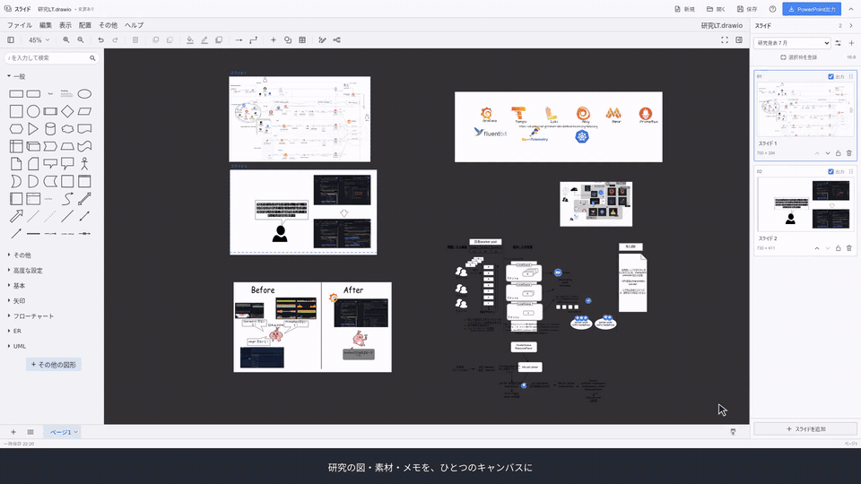

[](docs/demo.mp4?raw=true)

[動画の全編をダウンロード（MP4・約1分）](docs/demo.mp4?raw=true)

# draw.io Slides

日本語 | [English](README.en.md)

1つのdraw.ioキャンバスにスライド枠を配置し、指定した範囲をPowerPoint（`.pptx`）に書き出すローカルアプリケーションです。図や素材、メモを同じキャンバスに置いたまま、発表用のスライドを作成できます。

専用のdraw.io編集画面で作図し、画像としての出力と、PowerPointで編集できる形式での出力を選択できます。本プロジェクトはdraw.ioの非公式拡張です。

## 主な機能

- スライド枠の追加、既存の長方形の枠登録、枠のロック
- スライドの並べ替え、タイトル変更、出力対象の選択
- 複数の発表セットと、16:9・4:3の縦横比
- 作図とスライド設定をまとめた`.drawio`形式での保存
- 上部ツールバーとスライド一覧の折りたたみ

## 必要環境

- Node.js 22以上、npm
- Git、tar
- ChromeまたはEdgeなどのChromiumベースのブラウザー

初回セットアップでは、依存ライブラリとdraw.io本体のダウンロードにインターネット接続が必要です。

## インストールと起動

```sh
git clone https://github.com/lgtmmube/drawio-slides.git
cd drawio-slides
npm ci
npm run setup:editor
npm run build
npm start
```

ブラウザーで [http://127.0.0.1:48765/](http://127.0.0.1:48765/) が開きます。`setup:editor`はdraw.io本体を取得し、`build`は起動用のファイルを生成します。

次回以降は、プロジェクトのディレクトリで`npm start`を実行します。Windowsでは`start-drawio-slides.cmd`のダブルクリック、macOS・Linuxでは`./start-drawio-slides.sh`でも起動できます。

サーバーを起動したターミナルは、アプリの使用中は開いたままにします。終了する場合は作図を保存し、ターミナルで`Ctrl+C`を押します。

## 使い方

1. `.drawio`ファイルを開くか、新規作成します。サンプルは開始画面またはヘルプから開けます。
2. 「スライドを追加」を押し、キャンバス上で枠を配置する位置をクリックします。既存の長方形を使う場合は、選択して「選択枠を登録」を押します。
3. 枠内に作図し、右側の一覧でタイトル・順序・出力対象を設定します。
4. 「PowerPoint出力」で全スライドのプレビューを確認し、モードを選んで書き出します。一覧のスライドをクリックすると拡大表示でき、前後のスライドにも移動できます。出力対象は、現在のページで選択している発表セットです。
5. 「保存」で作図とスライド設定を`.drawio`ファイルに保存します。

枠は出力範囲を指定するガイドです。枠の移動や削除によって、中の図形は移動・削除されません。ガイドの枠線とタイトルは出力されません。

上部バーと右側の一覧は、端の矢印で折りたたみ・再表示できます。表示状態はブラウザーに保存されます。

## 出力モード

| モード | 出力内容 | PowerPointでの編集 |
| --- | --- | --- |
| 画像 | draw.ioの描画を、スライドごとに1枚の画像として配置 | 画像全体の移動・拡大縮小 |
| 編集可能 | 対応する文字・基本図形・矢印を個別の要素に変換。特殊な素材は画像として配置 | 対応する要素を個別に編集 |

画像モードは、元の図の配置や改行を維持したい場合に適しています。画像の横幅は1920px・3840pxから選べます。

編集可能モードでは、PowerPoint側のフォントや文字の折り返し、装飾によって見た目が変わる場合があります。矢印は個別に編集できますが、図形を移動した際の接続追従には対応していません。また、枠をまたぐ図形はスライド外に一部が残る場合があります。

## 保存とデータの扱い

作図とスライド設定は`.drawio`ファイルに保存され、通常のdraw.ioでも開けます。対応ブラウザーでは開いたファイルを更新し、それ以外ではファイルをダウンロードします。

作業中の下書きはブラウザーにも一時保存されます。一時保存はファイル保存の代替ではなく、ブラウザーのデータ削除などで失われます。

PowerPointファイルは出力のたびに新しく生成されます。PowerPointで行った変更は、draw.ioの作図には反映されません。

変換処理はブラウザー内で行います。外部URLの画像やWebフォントを使用する場合は、その取得先との通信が発生します。取得先のアクセス制限などにより、出力できない場合があります。

## 開発

依存ライブラリとdraw.io本体のセットアップ後、開発サーバーを起動します。

```sh
npm run dev
```

テストの実行：

```sh
npm test
node scripts/check-server.mjs
npx playwright install chromium
npm run test:browser
```

追加のエディター変換テストは、開発サーバーを起動した状態で実行します。

```sh
node tests/editor-bridge.browser.mjs
```

ブラウザーテストでは、`CHROME_PATH`でChromiumの実行ファイル、`APP_URL`で起動済みサーバーのURLを指定できます。

## サードパーティーライブラリ

draw.ioをはじめとする利用ライブラリのライセンスと著作権表示は、[THIRD_PARTY_NOTICES.txt](THIRD_PARTY_NOTICES.txt)を参照してください。取得したdraw.io本体のライセンスファイルは`public/editor/`にも保存されます。
